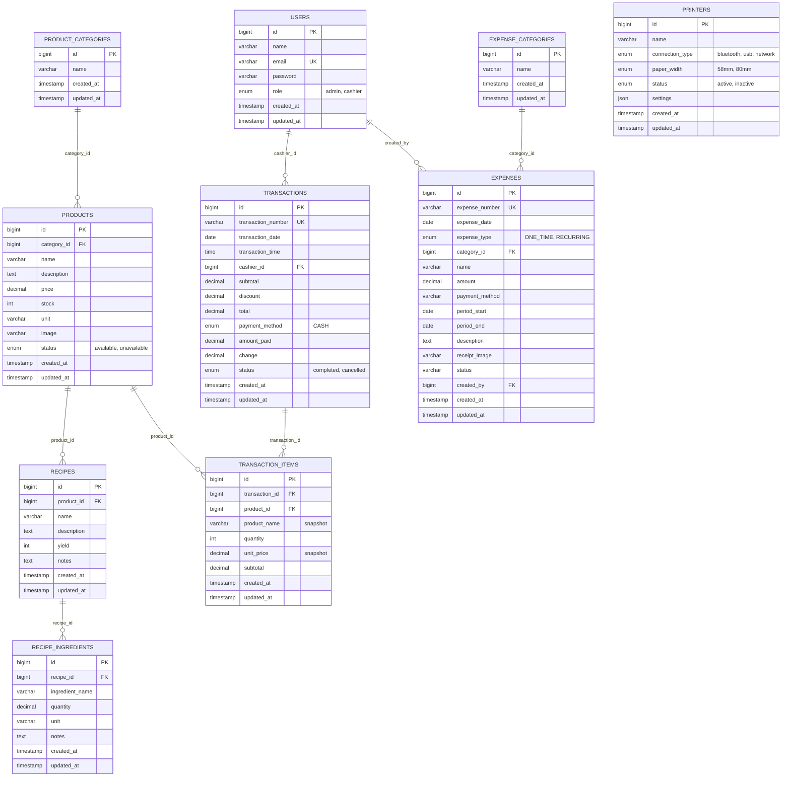

Pemodelan Data · Web & Mobile

# ERD Yan's Food

Satu database MySQL yang melayani Admin Web dan POS Kasir sekaligus — 10 entitas inti: Pengguna, Kategori Produk, Produk, Resep Dapur, Bahan Baku Resep, Transaksi Kasir POS, Item Transaksi, Kategori Biaya Operasional, Pengeluaran Dapur, dan Konfigurasi Printer Kasir.

**PK** primary key **FK** foreign key **UK** unique key **||--o{** satu ke banyak (1:N)

## Prinsip Model yang Diterapkan

SNAPSHOT

`product_name` & `unit_price` disalin permanen ke `transaction_items` saat transaksi dibuat, bukan di-lookup ulang ke `products` — supaya nota lama tetap akurat walau harga produk berubah di kemudian hari.

NO HARD DELETE

Produk yang sudah pernah terpakai di transaksi kasir tidak boleh dihapus secara permanen dari database — cukup diubah statusnya menjadi `unavailable`. Seluruh riwayat transaksi kasir dan laporan omset tetap utuh.

SERVER-SIDE TOTAL

`subtotal`, `total`, dan `change` selalu dihitung ulang oleh backend dari harga di database pada POS kasir. Client tidak pernah menjadi sumber kebenaran angka transaksi.

POTONG STOK OTOMATIS

Trigger MySQL `trg_after_transaction_item_insert` secara otomatis memotong stok produk saat detail item transaksi kasir berhasil tersimpan.

PESAN ONLINE & TAKEAWAY = INTEGRASI PLATFORM & WA

Link ShopeeFood / GoFood / GrabFood dan tombol Takeaway WhatsApp pada website company profile publik bersifat direct link & URL generator — tidak memerlukan tabel transaksional di database internal karena transaksi delivery diproses oleh mitra platform dan chat WhatsApp.

## Kardinalitas Relasi

| Entitas Induk | Relasi | Entitas Anak | Makna |
| --- | --- | --- | --- |
| `product_categories` | 1 : N | `products` | Satu kategori menaungi banyak produk |
| `products` | 1 : N | `recipes` | Satu produk bisa punya beberapa resep/BOM |
| `recipes` | 1 : N | `recipe_ingredients` | Satu resep terdiri dari beberapa bahan baku |
| `transactions` | 1 : N | `transaction_items` | Satu struk kasir POS berisi beberapa item menu |
| `products` | 1 : N | `transaction_items` | Satu produk muncul di banyak transaksi |
| `expense_categories` | 1 : N | `expenses` | Satu kategori menaungi banyak pengeluaran operasional |
| `users` | 1 : N | `transactions, expenses` | Jejak kasir/admin yang menginput transaksi & pengeluaran (audit trail) |

Yan's Food — Laravel · MySQL 8.x · POS Kasir, Manajemen Produk & Company Profile