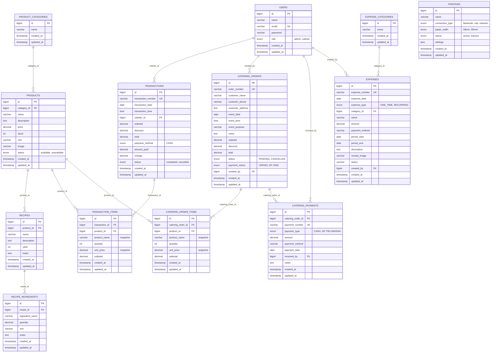

Pemodelan Data · Web & Mobile

# ERD Yan's Food

Satu database MySQL yang melayani Admin Web (Filament) dan Admin Mobile (Android) sekaligus — 13 entitas inti, diturunkan langsung dari spesifikasi fungsional dan hasil brainstorming modul Catering.

**PK** primary key **FK** foreign key **UK** unique key **||--o{** satu ke banyak (1:N)

## Prinsip Model yang Diterapkan

Setiap aturan di bawah ini berasal langsung dari spesifikasi & brainstorming modul Catering — bukan asumsi tambahan.

SNAPSHOT

`product_name` & `unit_price` disalin ke `transaction_items` dan `catering_order_items` saat transaksi dibuat, bukan di-lookup ulang ke `products` — supaya nota lama tetap akurat walau harga produk berubah di kemudian hari.

NO HARD DELETE

Produk yang sudah pernah terpakai di transaksi tidak boleh dihapus permanen — cukup diubah statusnya ke `unavailable`. Riwayat & laporan tetap utuh.

SERVER-SIDE TOTAL

`subtotal`, `total`, dan `change` selalu dihitung ulang oleh backend dari harga di database — baik di POS maupun form Pesan Katering publik. Client tidak pernah jadi sumber kebenaran angka.

DUA STATUS TERPISAH

`catering_orders.status` (progres pekerjaan) dan `payment_status` (progres pembayaran) independen satu sama lain — order `COMPLETED` tidak otomatis berarti `PAID`.

AGREGAT, BUKAN TABEL BARU

Page *Penghasilan Catering* dan section *Laporan Catering* tidak punya tabel sendiri — keduanya query agregat dari `catering_payments` ⋈ `catering_orders`.

PESAN ONLINE = KONFIG

Link ShopeeFood / GoFood / GrabFood di halaman Pesan & footer bersifat konten statis/pengaturan — sengaja tidak dimodelkan sebagai tabel transaksional karena checkout terjadi sepenuhnya di platform pihak ketiga.

## Kardinalitas Relasi

| Entitas Induk | Relasi | Entitas Anak | Makna |
| --- | --- | --- | --- |
| `product_categories` | 1 : N | `products` | Satu kategori menaungi banyak produk |
| `products` | 1 : N | `recipes` | Satu produk bisa punya beberapa resep/BOM |
| `recipes` | 1 : N | `recipe_ingredients` | Satu resep terdiri dari beberapa bahan |
| `transactions` | 1 : N | `transaction_items` | Satu struk POS berisi beberapa item |
| `products` | 1 : N | `transaction_items` | Satu produk muncul di banyak transaksi |
| `catering_orders` | 1 : N | `catering_order_items` | Satu pesanan katering berisi beberapa produk |
| `catering_orders` | 1 : N | `catering_payments` | Satu pesanan bisa dibayar bertahap (DP + Pelunasan) |
| `expense_categories` | 1 : N | `expenses` | Satu kategori menaungi banyak pengeluaran |
| `users` | 1 : N | `transactions, catering_orders, catering_payments, expenses` | Jejak siapa yang input/terima/mencatat (audit trail) |

Yan's Food — Laravel 13 · Filament v3 · MySQL 8.x · dikonsumsi bersama oleh Admin Web & Mobile via REST API yang sama